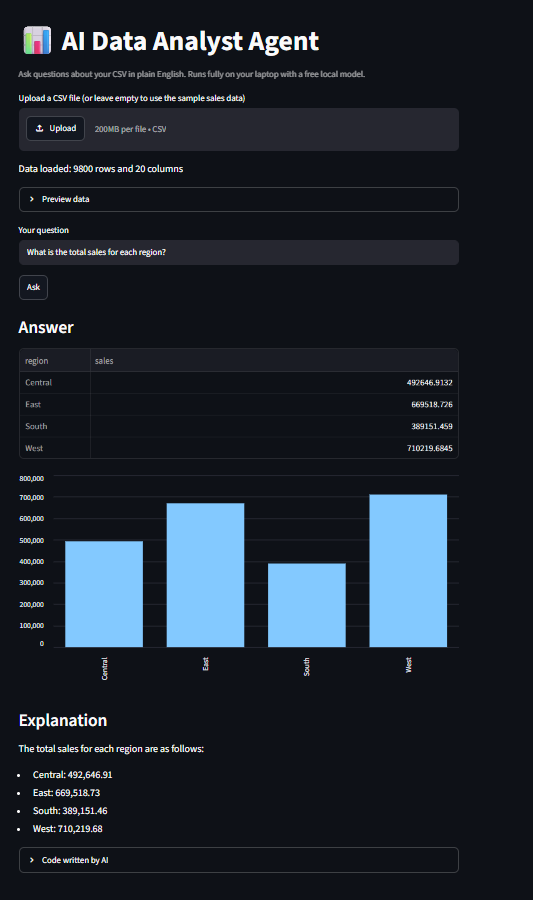

# AI Data Analyst Agent (free, runs locally)

Ask questions about a CSV file in plain English. A local AI model (Ollama + qwen2.5-coder 3b) writes pandas code, the app runs it, and shows the answer, a chart and a simple explanation. No API key and no cost.

## Demo

## How it works

1. The user uploads a CSV and asks a question
2. The model sees the column names, data types and first rows
3. It writes pandas code to answer the question
4. The app runs the code (with one automatic retry if it fails)
5. The result is shown as a table, a bar chart where it fits, and a short plain-English explanation

## Tech stack

Python, Pandas, Streamlit, Ollama (qwen2.5-coder:3b)

## How to run

1. Install Ollama from ollama.com
2. Download the model: ollama pull qwen2.5-coder:3b
3. Install the libraries: pip install -r requirements.txt
4. Start the app: streamlit run app.py

## Example questions (Superstore sales data)

- What is the total sales for each region?
- Show the top 5 customers by total sales
- Which month has the lowest total sales?

## Limitations

- It uses a small model, so it can write wrong code. Always verify important results.
- It runs AI-generated code on your own machine, so use it only locally with your own data, not as a public website.
- Date columns are read as day/month/year.

## Author

Shivam B. Dugale | https://www.linkedin.com/in/shivam-dugale-782468239
